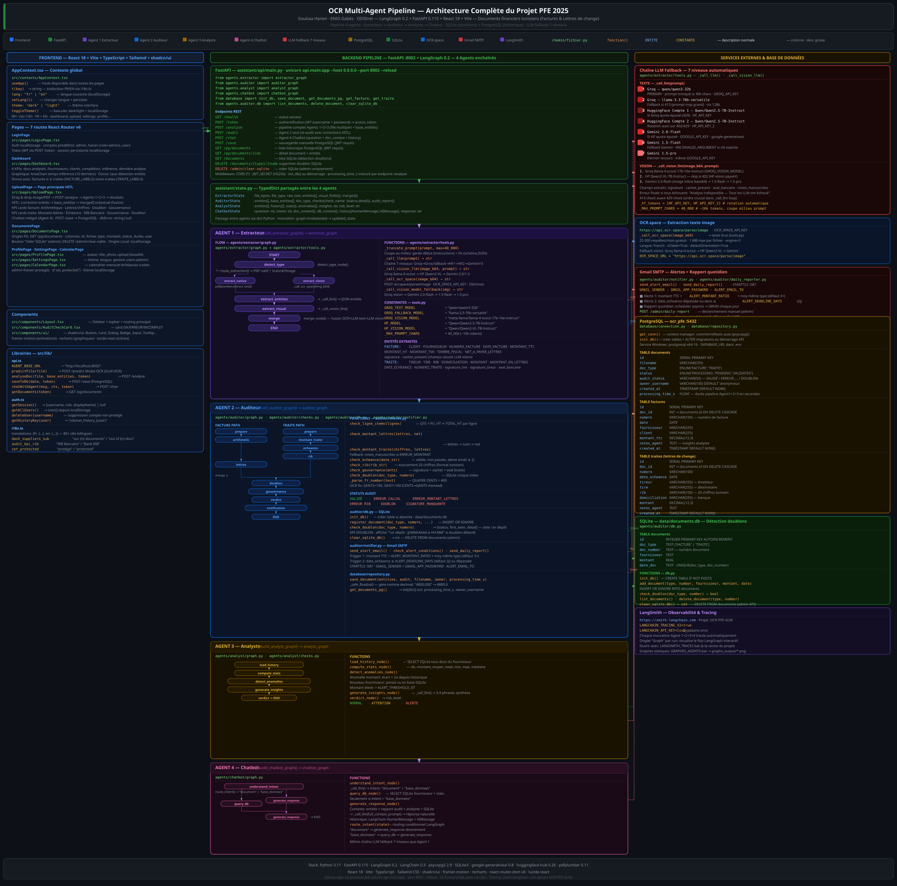

# ODSINET — Document AI for Invoices and Bills of Exchange

**Fine-tuned vision-language models and a multi-agent validation pipeline for business documents (French / Arabic / English)**

Final-year engineering project, 2026 — National Engineering School of Gabès (ENIG), carried out at Unilog (Sfax, Tunisia).

The system reads an invoice or a Tunisian bill of exchange (*lettre de change*) and returns its key fields as
structured JSON. A lightweight classifier routes each document to a dedicated **GLM-OCR** model fine-tuned with
**LoRA**; a **LangGraph** multi-agent pipeline then enriches, audits and analyses the result, with a human-in-the-loop
review step before anything is stored.

---

## Results

All figures come from the evaluation notebooks in this repository and are computed on held-out test documents.

| Model | Task | Test set | Main result |
|---|---|---|---|
| GLM-OCR + LoRA (invoices) | 5 fields | 801 invoices | **97.40 % field-level F1**, 89.89 % exact match (all fields correct) |
| GLM-OCR + LoRA (bills of exchange) | 7 fields | 39 real scanned documents | **97.4 % of documents fully correct** (CER 0.1 %) |
| GLM-OCR + LoRA (bills of exchange) | 7 fields | 1,065 documents incl. augmented and synthetic | 92.8 % mean field accuracy, 71.5 % fully correct |
| MobileNetV2 | Invoice vs bill of exchange | 322 images | **99.69 % accuracy** (1 error) |

Inference takes ≈ 4.9 s per invoice on a Tesla T4. Per-field results, protocols and limitations are given in the
[evaluation notebooks](evaluation/).

## Research approach

1. **Zero-shot benchmark** ([`research/zero_shot_benchmark.ipynb`](research/zero_shot_benchmark.ipynb)) — ten models
   compared without fine-tuning on 389 annotated real documents: classical OCR (Tesseract, docTR, TrOCR),
   layout-aware models (LayoutLMv2, LayoutXLM) and vision-language models (GLM-OCR, Qwen2-VL-2B, Gemma 3 4B).
   GLM-OCR ranked first on the composite score (0.655 vs 0.509 for the runner-up), which motivated its choice.
2. **Parameter-efficient fine-tuning** ([`training/`](training/)) — LoRA adapters (r = 4, 0.25 % of the 1.1 B
   parameters) trained on a T4 GPU over several resumable sessions; see the [training log](training/TRAINING_LOG.md).
   A LayoutXLM token-classification model and a Qwen2-VL-7B QLoRA model were also trained during the project and
   discarded in favour of GLM-OCR.
3. **Evaluation** ([`evaluation/`](evaluation/)) — field-level precision, recall and F1, exact match, CER/WER, and a
   breakdown by document origin (real, augmented, synthetic).
4. **Agentic validation** ([`assistant/`](assistant/)) — LangGraph agents that extract additional fields, audit
   arithmetic and duplicates deterministically, flag anomalies and answer questions about the documents.

### Data

The documents belong to the host company's clients and are **not distributed**; only code, metrics and model
weights are published. Train/test splits (80/20) were made on the original documents **before** augmentation, so
augmented versions of a test document never appear in training.

| Dataset | Real | Augmented | Synthetic | Total | Train / test |
|---|---|---|---|---|---|
| Invoices | 194 | 2,910 | 900 | 4,004 | 3,203 / 801 |
| Bills of exchange | 195 | 3,900 | 1,228 | 5,323 | 4,258 / 1,065 |

Augmentation: geometric and photometric transforms with noise (albumentations, 15 variants per image).
Synthetic documents were generated with Pillow and ReportLab. Annotation: Label Studio.

### Limitations

- There was no separate validation split: the test split was also used to select the best checkpoint during
  training, so the reported scores may be slightly optimistic.
- Only 39 real documents per type are available for testing.
- The zero-shot F1 (regular expressions applied to raw model output) is not comparable with the field-level F1 of
  the fine-tuned models.

### Published models (Hugging Face)

| Model | Repository |
|---|---|
| GLM-OCR invoices (LoRA merged) | [`Goubaa/glmocr-factures`](https://huggingface.co/Goubaa/glmocr-factures) |
| GLM-OCR bills of exchange | [`Goubaa/glm-traite-tunis`](https://huggingface.co/Goubaa/glm-traite-tunis) |
| MobileNetV2 classifier | [`Goubaa/mobilenet-classifier`](https://huggingface.co/Goubaa/mobilenet-classifier) |
| LayoutXLM invoices (discarded baseline) | [`Goubaa/layoutxlm-factures`](https://huggingface.co/Goubaa/layoutxlm-factures) |

---

## Repository structure

```
├── research/      zero-shot benchmark notebook
├── training/      fine-tuning notebooks (GLM-OCR invoices, bills of exchange, MobileNetV2) + training log
├── evaluation/    evaluation notebooks with metrics
├── backend/       GLM-OCR inference API (FastAPI, port 7860)
├── modal_app.py   GPU deployment of the inference API on Modal
├── assistant/     LangGraph agents + API (FastAPI, port 8002)
├── local_api/     bridge between the interface and PostgreSQL (FastAPI, port 8001)
├── frontend/      React + Vite interface with human-in-the-loop review (port 3000)
├── diagrams/      architecture (SVG) + class, sequence and use-case diagrams (PlantUML)
└── scripts/       Windows launchers
```

## Getting started

Requirements: Python 3.10+, Node.js 18+, PostgreSQL 16, and a GPU for local GLM-OCR inference (or a Modal account).

```bash
# 1. Agents backend
cd assistant
python -m venv venv && source venv/bin/activate      # Windows: venv\Scripts\activate
pip install -r requirements.txt
cp .env.example .env                                  # then fill in the API keys
uvicorn api.main:app --host 0.0.0.0 --port 8002 --reload

# 2. GLM-OCR inference API (local GPU)
cd backend
pip install -r requirements.txt
uvicorn main:app --port 7860

# 3. Frontend
cd frontend
npm install
cp .env.example .env
npm run dev                                           # http://localhost:3000
```

### Deploying the inference API on Modal

```bash
pip install modal
modal setup                       # authenticate once
modal deploy modal_app.py         # T4 GPU, model weights cached in a Modal volume
```

Set `VITE_API_URL` in `frontend/.env` to the URL printed by `modal deploy`. The endpoint is public by default:
protect it (for example with a Modal proxy token) before sharing it.

---

## System architecture



```
                         ┌──────────────────────────────┐
  Invoice / bill of      │  Frontend (React + Vite)     │  upload, human-in-the-loop review,
  exchange (image/PDF) ─▶│  :3000                       │  dashboard, history, chatbot
                         └──────┬───────────────┬───────┘
                                │               │
                 POST /predict  │               │  POST /analyse, /audit, /analyst, /chat
                                ▼               ▼
  ┌──────────────────────────────────┐   ┌──────────────────────────────────────────┐
  │ Inference API (Modal T4 / :7860) │   │ Agents API (FastAPI + LangGraph) :8002   │
  │ 1. MobileNetV2 → document type   │   │ Agent 1 Extractor  → extra fields        │
  │ 2. GLM-OCR invoices  (5 fields)  │   │ Agent 2 Auditor    → deterministic checks│
  │    GLM-OCR bills     (7 fields)  │   │ Agent 3 Analyst    → anomalies, insights │
  └──────────────────────────────────┘   │ Agent 4 Chatbot    → questions on data   │
                                         └───────────────────┬──────────────────────┘
                                                             ▼
                                                   PostgreSQL 16 (documents,
                                                   invoices, bills of exchange)
```

Processing flow: **classify → extract the main fields with GLM-OCR → human review and correction →
Extractor agent (additional fields) → Auditor → Analyst → storage**; the chatbot can be used at any time.

## Inference API — [`modal_app.py`](modal_app.py), [`backend/`](backend/)

| Route | Description |
|---|---|
| `POST /predict` | Classifies the document (MobileNetV2, CPU) unless the type is forced, then runs the matching GLM-OCR model (T4 GPU) and returns the fields as JSON with timings |
| `GET /labels` | Fields supported for each document type |
| `GET /health` | Status and loaded models |

`modal_app.py` is the GPU deployment used in production (both GLM-OCR models + classifier, weights cached in a Modal
volume); `backend/main.py` is the same API for a local GPU (invoice model only) and `backend/Dockerfile` packages it.

## Agents API — [`assistant/`](assistant/)

| Route | Agents | Description |
|---|---|---|
| `POST /analyse` | 1 → 2 → 3 | Full pipeline on an uploaded document |
| `POST /audit` | 2 | Re-audits a corrected JSON (after human review) |
| `POST /analyst` | 3 | Re-analyses a corrected JSON |
| `POST /chat` | 4 | Chatbot with the context of the current document |
| `POST /save` | — | Saves the (corrected) entities to PostgreSQL |
| `GET /pg/documents`, `GET /pg/documents/{id}` | — | History and document details |
| `DELETE /documents/{type}/{number}` | — | Deletes a document (admin) |
| `DELETE /admin/clear-documents`, `POST /admin/daily-report` | — | Administration |
| `POST /token`, `GET /health` | — | JWT issuance and health check |

### LangGraph agents

| Agent | Graph | Role |
|---|---|---|
| 1 — Extractor | `detect_type → extract_native / extract_vision → extract_entities → extract_visual → merge` | Reads native PDFs (pdfplumber) or runs OCR (OCR.space, vision-LLM fallback), extracts 30+ complementary fields with an LLM (items, taxes, contact details) and visual cues with a vision model (stamps, signatures, handwriting) |
| 2 — Auditor | `prepare → (invoice) arithmetic → lettres` / `(bill) montant_traite → echeance → rib` `→ doublon → gouvernance → verdict → notification` | **Pure Python, no LLM**: line arithmetic, amount in words vs figures, due date, 20-digit RIB, duplicates in PostgreSQL, signatures/stamps; e-mail alerts |
| 3 — Analyst | `load_history → compute_stats → detect_anomalies → generate_insights → verdict` | Compares the document with the supplier history, flags unusual amounts and writes a short analysis |
| 4 — Chatbot | `understand_intent → query_db → generate_response` | Answers questions about the current document or the stored history |

LLM providers (with automatic fallback): Groq (Qwen3-32B, Llama 3.1, Llama 4 Scout vision), Google Gemini,
Hugging Face Inference, OpenAI (Analyst and last resort). Audit status codes (`VALIDÉ`, `DOUBLON`, `ERREUR_CALCUL`,
`ERREUR_MONTANT_LETTRES`, …) are kept in French because they are part of the API contract.

## Frontend — [`frontend/`](frontend/)

React 18, TypeScript, Vite, Tailwind CSS, shadcn/ui (Radix), Recharts. Interface in English and French.

| Page | Route | Content |
|---|---|---|
| Upload | `/upload` | Upload or camera capture, extracted fields with inline correction, agent results |
| Dashboard | `/` | KPIs, document-type distribution, inference times |
| Documents | `/documents` | History stored in PostgreSQL, search, administration |
| Calendar | `/calendar` | Documents processed per day |
| Profile, Settings | `/profile`, `/settings` | Account, theme, language, users (admin) |

Authentication in the frontend is a local demo (localStorage); the agents API issues a signed JWT used for the
protected routes.

## Technical stack

| Layer | Technologies |
|---|---|
| Models | GLM-OCR (Zhipu AI) + LoRA (PEFT), MobileNetV2 (PyTorch), Hugging Face Transformers |
| Training | Kaggle (Tesla T4), FP16, gradient accumulation, NEFTune |
| Serving | FastAPI, Modal (GPU), Docker |
| Agents | LangGraph, LangChain, Groq, Gemini, OCR.space, pdfplumber |
| Data | PostgreSQL 16 (psycopg2) |
| Frontend | React, TypeScript, Vite, Tailwind CSS, shadcn/ui, Recharts |

---

*Final-year engineering project, 2026 · Hanen Goubaa · National Engineering School of Gabès (ENIG) · hosted by Unilog, Sfax*
